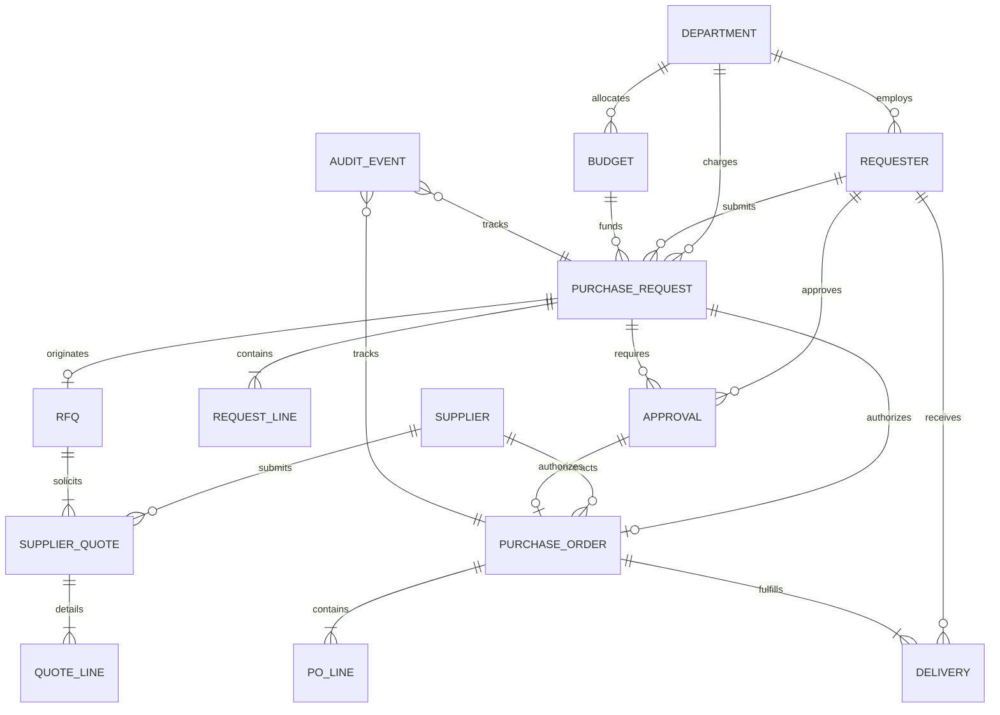
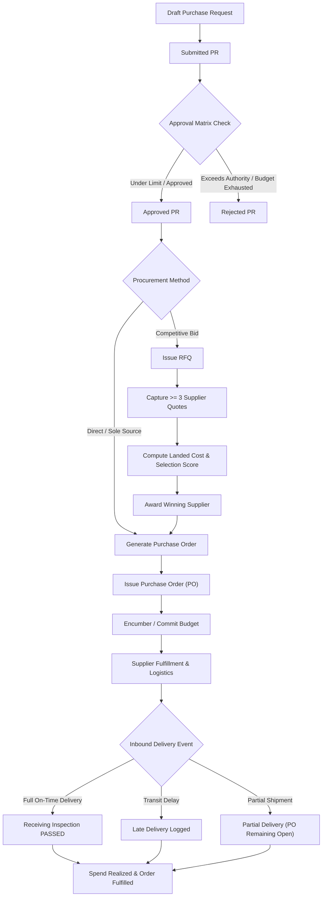

# Enterprise Procurement & Sourcing Architecture

## 1. System Overview

The Yottaflex Procurement Engine is an end-to-end, auditable enterprise workflow platform managing purchase requests, competitive quote comparisons, multi-tier approvals, purchase orders, and supplier delivery verification.

Key design principles:
- **Traceability First**: State transitions are never overwritten; every status modification appends an immutable `AuditEvent`.
- **Explainable Decisions**: Supplier award decisions calculate total landed cost and multi-attribute selection scores with auditable rationales.
- **Relational Integrity**: Strict foreign key constraints and primary key uniqueness across 100% of tables.
- **Isolated Ground Truth**: Known anomalies and edge cases are generated from deterministic rules and kept in a separate `ground_truth` table to prevent feature leakage.

---

## 2. Entity Relationship Diagram (ERD)

### Cardinality Summary
- **Department $\rightarrow$ Budget**: `1:N` (A department has multiple categorical budgets for fiscal year 2026).
- **Department $\rightarrow$ Requester**: `1:N` (Employees belong to one department).
- **PurchaseRequest $\rightarrow$ RequestLine**: `1:N` (A PR has 1 to 4 itemized lines).
- **PurchaseRequest $\rightarrow$ RFQ**: `1:1` (Eligible competitive PRs trigger exactly one RFQ).
- **RFQ $\rightarrow$ SupplierQuote**: `1:N` (Competitive RFQs solicit at least 3 supplier quotes).
- **SupplierQuote $\rightarrow$ QuoteLine**: `1:N` (Quotes detail itemized line pricing).
- **PurchaseOrder $\rightarrow$ POLine**: `1:N` (PO lines match awarded quote lines exactly).
- **PurchaseOrder $\rightarrow$ Delivery**: `1:N` (Orders are delivered in 1 full shipment or 2 partial shipments).

---

## 3. End-to-End Workflow State Machine

---

## 4. Multi-Tier Approval Threshold Matrix

| Tier Level | Financial Range (USD) | Authorized Signer Role | Minimum Approval Limit |
| :--- | :--- | :--- | :--- |
| **Tier 1 (Manager)** | $\$0.00 - \$999.99$ | Team Lead / Staff Specialist | $\$1,000.00$ |
| **Tier 2 (Dept Head)** | $\$1,000.00 - \$9,999.99$ | Department Manager | $\$10,000.00$ |
| **Tier 3 (Finance Director)** | $\$10,000.00 - \$49,999.99$ | Director / Senior Director | $\$50,000.00$ |
| **Tier 4 (Executive)** | $\$50,000.00+$ | Vice President / CFO | $\$250,000.00+$ |

### Separation of Duties
1. A requester cannot approve their own purchase request.
2. If an approver in the requesting department does not meet the financial threshold, the request is escalated to the global authority pool (Directors, VPs).
3. Over-budget requests require documented justification and override approvals.

---

## 5. Quote Evaluation & Total Landed Cost Model

Landed cost normalizes international supplier pricing to USD:

$$\text{Total Landed Cost (USD)} = \left(\text{Base Quote Amount} - \text{Discount} + \text{Freight} + \text{Duties/Taxes}\right) \times \text{Exchange Rate}$$

### Multi-Criteria Selection Scoring Formula (0 to 100 points)

$$\text{Score} = \underbrace{50 \times \left(\frac{\text{Lowest Landed Cost}}{\text{Quote Landed Cost}}\right)}_{\text{Cost Score (50 pts)}} + \underbrace{25 \times \max\left(0, \frac{45 - \text{Lead Time Days}}{45}\right)}_{\text{Delivery Velocity Score (25 pts)}} + \underbrace{\left(\frac{\text{Rating}}{5.0} \times 15\right) + (\text{Quality} \times 10)}_{\text{Supplier Reputation Score (25 pts)}}$$

- **Award Justification Rule**: If the quote with the lowest total landed cost is awarded, the rationale records cost efficiency. If a higher-cost quote is awarded due to superior score (e.g. 5-day lead time vs 28 days), a documented rationale is recorded in `award_rationale`. If a higher-cost quote is awarded without rationale, it is flagged as an anomaly.

